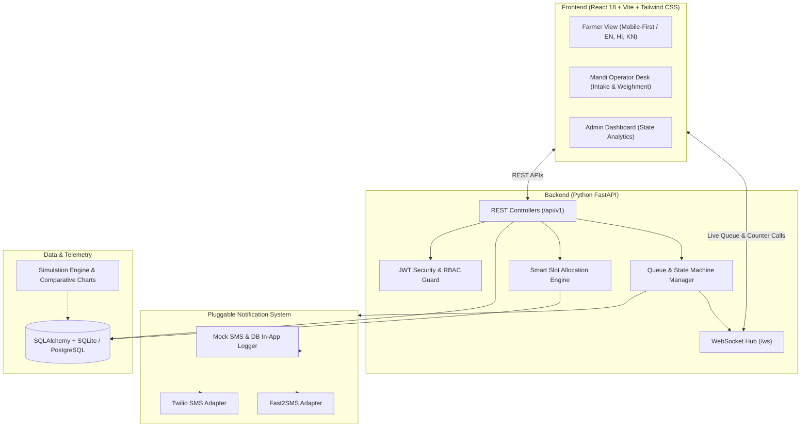
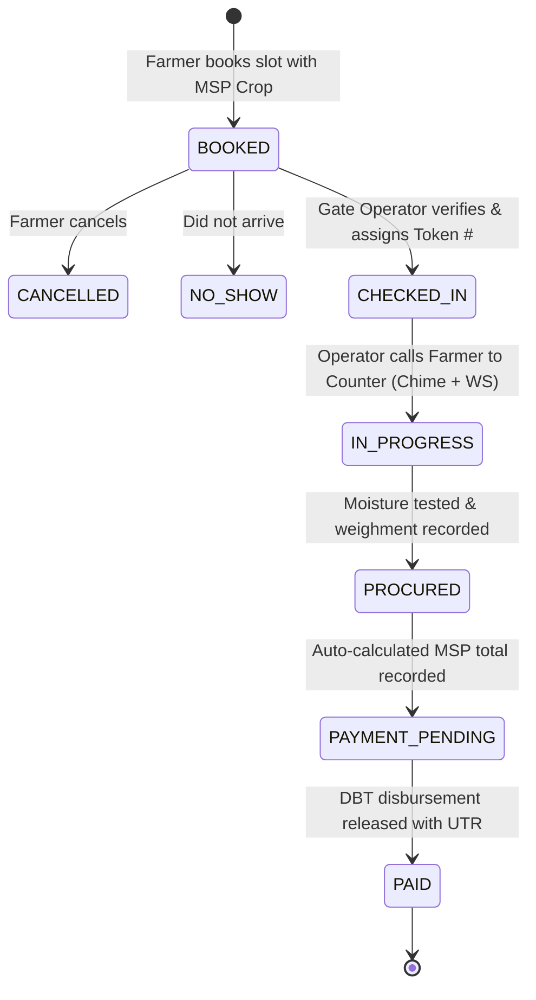

# KisanSlot 
### Smart Agricultural Procurement Slot Booking & Real-Time Queue Management System
**College Major Project** | Full-Stack Web Application

---

##  1. Problem Statement
Farmers in India and across developing agrarian economies routinely face severe bottlenecks at Agricultural Produce Market Committees (APMC) and government procurement centres:
1. **Unpredictable, Long Waiting Times:** Unregulated walk-in arrivals (First-Come-First-Served) create massive morning gridlocks where tractors and trucks wait in line for **4 to 16+ hours**, frequently forcing farmers to camp overnight on roadside highways.
2. **Information Asymmetry:** Farmers lack transparency regarding daily procurement quotas, counter operating speeds, and inspection schedules.
3. **Delayed Payouts & Uncertainty:** Uncertain procurement confirmation and delayed payment settlements cause financial distress.
4. **Mandi Congestion:** Procurement centres face chaotic peaks in the early morning followed by underutilized weighbridges in the afternoon.

### The KisanSlot Solution
**KisanSlot** introduces smart time-window slot allocation, anti-overbooking capacity guarantees, dynamic lot-size handling time estimation, live WebSocket-driven queue telemetry, and automated Direct Benefit Transfer (DBT) payment triggers.

---

##  2. System Architecture



---

## 3. Technology Stack

- **Backend:** Python 3.12, FastAPI, SQLAlchemy 2.0, Pydantic v2, SQLite (swappable to PostgreSQL via `DATABASE_URL`).
- **Real-Time Layer:** Native WebSockets (`/ws/centres/{id}`, `/ws/farmers/{id}`, `/ws/global`) with bi-directional pub-sub event dispatching.
- **Frontend:** React 18, Vite, Tailwind CSS, Lucide Icons, Web Audio API chime synthesis.
- **Internationalization (i18n):** Tri-lingual native support for **English**, **Hindi (हिंदी)**, and **Kannada (ಕನ್ನಡ)**.
- **Pluggable Notifications:** Default in-app persistent logger + console mock SMS with ready-to-activate Twilio and Fast2SMS adapters.
- **Analytics & Simulation:** Matplotlib, NumPy discrete-event queue simulation (500+ synthetic farmers, 3 APMC centres, 5-day horizon).

---

##  4. Booking Lifecycle State Machine



---

##  5. Smart Slot Allocation & Wait Estimator

1. **Anti-Overbooking Guarantee:**
   $$\text{Slot Booked Capacity} + \text{Requested Quantity} \le \text{Max Slot Capacity}$$
2. **Handling Time Duration Modeling:**
   $$T_{\text{service}} = T_{\text{base}} + \left(\frac{\text{Quantity (Quintals)}}{10} \times \text{Crop Unit Handling Rate}\right)$$
   *(e.g. Wheat = 4 min/10Q, Cotton = 8 min/10Q)*
3. **Dynamic Wait Time Estimator:**
   $$\text{Estimated Wait (mins)} = \frac{\sum_{i=1}^{k} \text{Remaining Service Time of Farmers Ahead}}{\text{Active Working Counters}}$$

---

## 6. Simulation & Benchmark Results

A discrete-event simulation (`simulation/simulate.py`) was run modeling **500 synthetic farmers across 3 procurement hubs over a 5-day drive**:

| Performance Metric | Scenario A: Unregulated FCFS Walk-in | Scenario B: KisanSlot Smart Allocation | Impact |
| :--- | :--- | :--- | :--- |
| **Average Wait Time** | **4.3 hours (255 mins)** | **13.1 minutes** | **↓ 94.9% Reduction** |
| **90th Percentile Wait** | **8.7 hours (521 mins)** | **40.0 minutes** | **Predictable turnaround** |
| **Max Bottleneck Delay** | **16.6 hours (996 mins)** | **89.0 minutes** | **Zero overnight camping** |
| **Peak Day-1 Hour Intake** | **92 trucks/hour** *(Severe choke)* | **13 trucks/hour** *(Smooth intake)* | **Congestion eliminated** |
| **Overnight Spillover** | High (Farmers camp on road) | **Zero (Eliminated)** | **Enhanced farmer dignity** |

Generated charts are saved in `simulation/output/`:
- `wait_time_comparison.png` — Before/After Bar Chart
- `hourly_congestion_comparison.png` — Hourly Mandi Traffic Distribution Curve

---

## 7. Seed Accounts & Demo Credentials

The database is pre-seeded with realistic data across 3 procurement hubs (Dharwad, Mandya, Bhopal):

| Role | Name / Description | Mobile / Username | Password | Language |
| :--- | :--- | :--- | :--- | :--- |
| **Farmer 1** | Ramesh Patil | `9876543210` | `Farmer@123` | ಕನ್ನಡ (Kannada) |
| **Farmer 2** | Suresh Kumar | `9876543211` | `Farmer@123` | हिंदी (Hindi) |
| **Farmer 3** | Anil Gowda | `9876543212` | `Farmer@123` | English |
| **Operator** | Dharwad APMC Desk | `8888888888` | `Operator@123` | English / Kannada |
| **Admin** | State Procurement Director | `9999999999` | `Admin@123` | English |

> **Pro Tip:** In the frontend, use the **1-Click Demo Login** buttons on the login screen or use the floating **"Demo Role View"** pills at the top to seamlessly switch roles during an examination or demo!

---

##  8. Quick Start & Setup Guide

### 1. Backend Setup
```bash
cd backend
python -m pip install -r requirements.txt
python -m app.seed
python -m uvicorn app.main:app --host 127.0.0.1 --port 8000 --reload
```
- Interactive Swagger API Documentation: [backend](https://kisanslot-backend-fyn9.onrender.com/docs)
- WebSocket Endpoint: `ws://localhost:8000/ws`

### 2. Frontend Setup
```bash
cd frontend
npm install
npm run dev
```
- Open your browser to [Kisanslotbooking](kisanslot-sooty.vercel.app)

### 3. Run Benchmark Simulation
```bash
python simulation/simulate.py
```

---

## 9. Automated Tests
```bash
cd backend
pytest tests -v
```
All allocator unit tests and the end-to-end booking-to-procurement lifecycle tests run and pass cleanly.

---

##  10. Project Directory Layout
```text
kisanslot/
├── backend/
│   ├── app/
│   │   ├── api/          # REST route handlers (auth, centres, slots, queue, etc.)
│   │   ├── models/       # SQLAlchemy models (User, Slot, Booking, Procurement, etc.)
│   │   ├── schemas/      # Pydantic v2 schemas
│   │   ├── services/     # Allocator, QueueManager, WebSocketHub, Pluggable Notifications
│   │   ├── config.py     # Application settings
│   │   ├── database.py   # DB Engine & Session
│   │   ├── main.py       # FastAPI entrypoint & WebSockets
│   │   └── seed.py       # Database demo data seeder
│   ├── tests/            # Unit & Integration test suites
│   └── requirements.txt
├── frontend/
│   ├── src/
│   │   ├── components/   # Navbar, AudioAlert, NotificationModal
│   │   ├── pages/        # FarmerDashboard, OperatorDesk, AdminAnalytics, AuthPage
│   │   ├── i18n/         # English, Hindi, Kannada translation catalogs
│   │   ├── api.js        # API & WebSocket client
│   │   ├── App.jsx
│   │   └── main.jsx
│   ├── package.json
│   └── vite.config.js
├── simulation/
│   ├── simulate.py       # 500-farmer benchmark discrete-event simulation
│   └── output/           # Generated comparison charts (PNG)
├── docs/                 # Architecture specifications
└── README.md
```
